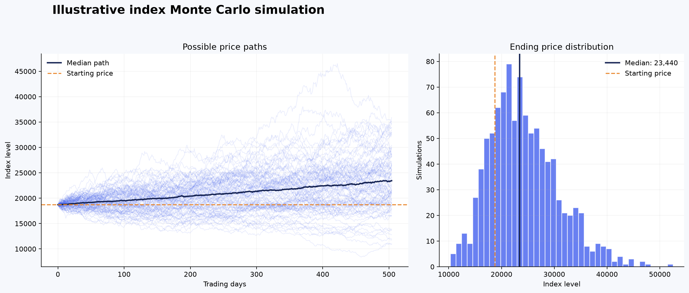

# Nasdaq 100 Monte Carlo Simulator

Explore a range of possible Nasdaq 100 index paths using historical daily returns. The project downloads adjusted closing prices from Yahoo Finance, estimates the distribution of daily log returns, and simulates future paths with geometric Brownian motion.



*Example output generated from synthetic prices for a reproducible illustration; it is not current market data.*

## Getting started

Requires Python 3.10 or newer and an internet connection for Yahoo Finance data.

```bash
git clone https://github.com/ginolaratro/monte-carlo-sim-v1.git
cd monte-carlo-sim-v1
python3 -m venv .venv
source .venv/bin/activate  # Windows: .venv\Scripts\activate
pip install -e '.[dev]'
nasdaq-monte-carlo
```

The default run uses two years of `^NDX` history, 1,000 paths, 504 trading days, and a fixed random seed. It prints the historical daily log return and volatility, and the 5th, 50th, and 95th percentiles of simulated ending levels. The chart is saved to `output/simulation.png`.

```bash
nasdaq-monte-carlo --ticker '^NDX' --period 2y --days 252 --simulations 5000 --seed 123 --output output/one-year.png
nasdaq-monte-carlo --csv prices.csv --output output/local.png
nasdaq-monte-carlo --help
```

For offline input, provide a CSV with a numeric `Close` column in chronological order, oldest first. The ticker option labels the chart when using a CSV. The included [notebook](monte_carlo_sim_v1.ipynb) offers an interactive version; install the development dependencies above and run `jupyter notebook` from the project directory.

## Method and limitations

The simulator estimates the mean and sample standard deviation of daily log returns from the supplied history, samples independent normally distributed log returns, and compounds them from the latest close. It assumes those parameters remain constant and uses 252 trading days per year. The percentile range describes this model's simulated outcomes, not a guarantee or a confidence interval for the actual market. Real returns can have changing volatility, extreme events, and dependencies that this model does not capture. Results are sensitive to the historical window and random seed. This is an educational tool, not investment advice.

## Development

```bash
pytest
```
